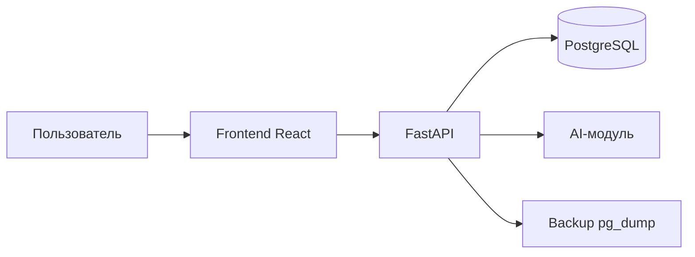

# Архитектура

## Компоненты

- **Frontend** (React + Vite) — SPA, 3 кабинета (админ, преподаватель, обучающийся)
- **Backend** (FastAPI) — REST API, RBAC, бизнес-логика
- **PostgreSQL** — единая база данных
- **AI-модуль** (Python) — scoring, grammar, insights
- **Backup** (APScheduler + pg_dump) — ежедневный дамп

## Схема

## Безопасность

- JWT (HS256), TTL 8 часов
- RBAC: admin / teacher / student
- Аудит всех действий в `audit_logs`
- TLS/SSL внутри контура (nginx self-signed)
- Хранение логов ≥ 6 мес.

## Изоляция

- Все сервисы в Docker Compose в приватной сети
- Нет обращений к внешним API
- LLM (опционально) — локальный Ollama